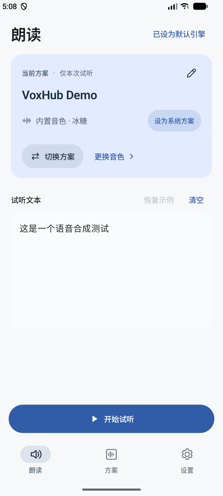
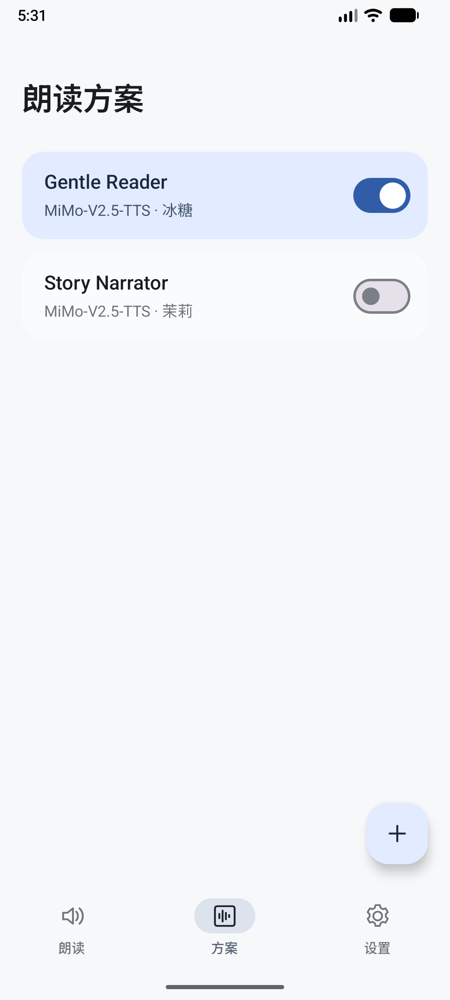
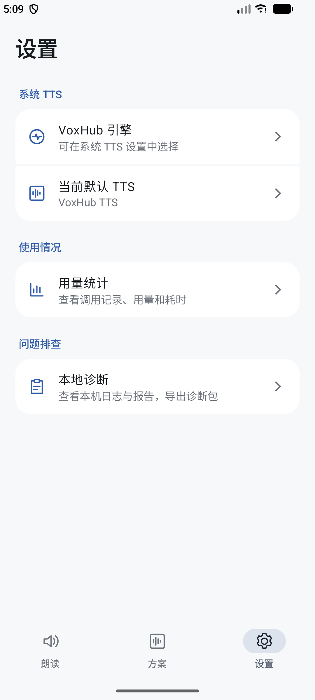

<div align="center">
  
  <h1>VoxHub</h1>

  <p>
    
    
    
  </p>
</div>

VoxHub 是一款面向 Android 的 AI 文字转语音客户端，通过标准系统 TTS 接口，将云端语音合成能力接入阅读器及其他支持 Android TTS 的应用。

## 功能

- **系统 TTS 集成**：实现 Android 标准 TTS 接口，无缝接入开源阅读、静读天下等各类支持系统 TTS 的第三方应用。
- **多模式语音合成**：全面支持 Xiaomi MiMo-V2.5-TTS 系列，以及计划中的更多 TTS 提供商支持。
- **本地安全与隐私保护**：API Key 加密存储；隐私优先，不保存任何朗读正文。
- **低资源占用**：安装包仅数 MB，TTS 合成时占用不到 100MB。

> *Xiaomi MiMo-V2.5-TTS 限时免费 [https://platform.xiaomimimo.com/console](https://platform.xiaomimimo.com/console)*

## 预览

<div align="center">
  
  
  
</div>

## 快速开始

1. 前往 [Releases 页面](https://github.com/Procyon-3/VoxHub/releases) 下载并安装最新的 APK。
2. 从受支持的 TTS 服务提供商处申请 API Key。
3. 打开 VoxHub，在方案标签页添加一个语音合成方案并启用。
4. 在设置标签页将 VoxHub 设置为系统默认 TTS 引擎。
5. （可选）将 VoxHub 加入安卓电池优化白名单。
6. 在开源阅读、静读天下等支持系统 TTS 的第三方应用中选择系统 TTS，即可使用 VoxHub 进行语音合成。

## Q&A

**Q：为什么 TTS 运行一段时间后就不工作了？**  
A：部分系统采用较为严格的后台管理策略，VoxHub 的服务可能在转入后台后，被冻结或杀死。需要为 VoxHub 添加电池优化白名单。具体操作步骤因不同手机厂商而异。

## 目前支持的 TTS 服务提供商
- Xiaomi MiMo-V2.5-TTS

## 本地构建

构建需要 JDK 25 和 Android SDK 37，使用仓库自带的 Gradle Wrapper。

可直接构建 Debug 版本：
```bash
# 克隆仓库
git clone https://github.com/Procyon-3/VoxHub.git
cd VoxHub
# 使用 Gradle 编译 Debug APK
./gradlew assembleDebug
```

## CI 与发布

Pull Request 和 `main` 分支提交会自动执行协议测试、应用单元测试、Android Lint 和 Debug 构建。

版本号统一在 `gradle.properties` 中维护：`appVersionName` 使用语义化版本号，`appVersionCode` 每次发布递增，保证 Android 可以覆盖升级。

发布流程：

1. 更新 `appVersionName` 和 `appVersionCode`，提交并等待 CI 通过。
2. 为该提交创建并推送正式版本 Tag，例如：

   ```bash
   git tag -a v1.0.1 -m "Release 1.0.1"
   git push origin v1.0.1
   ```

3. Release 工作流校验 Tag 与版本配置一致，重新执行 CI，构建并验证签名 APK，自动创建 GitHub Release，上传 APK 和 SHA-256 校验文件。R8 映射保存为 Actions Artifact。

目前接受 `v主版本.次版本.修订号` 格式的正式版本，例如 `v1.0.1`；预发布版本尚未启用。

仓库需配置以下 Actions Secrets，且后续版本必须沿用同一发布证书：

| Secret | 内容 |
| --- | --- |
| `ANDROID_KEYSTORE_BASE64` | PKCS#12 发布证书文件的 Base64 内容 |
| `ANDROID_SIGNING_PROPERTIES` | 完整的 `keystore.properties` 内容，参考 `keystore.properties.example`，其中 `storeFile=signing/release.p12` |

日常 CI 不使用签名 Secrets。仅 Release 构建恢复签名文件，完成后清理。

## 开源许可证

本项目基于 [GPL-3.0](LICENSE) 开源。
